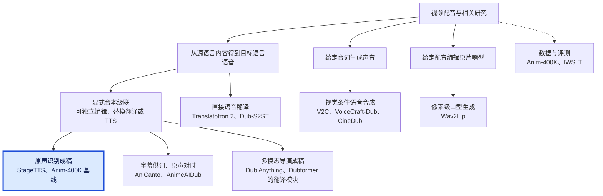

# 跨语言动漫配音方法综述与 StageTTS 定位

**StageTTS 属于保留原画面的、以可编辑台本为中间表示的级联式跨语言配音系统。** 以视频重配模式为例，它从原声识别日语台词并聚类说话人，由 LLM 生成译文和表演标签，再按角色合成、按时间轴拼轨。与它最接近的系统是 AniCanto 和 Dub Anything。三者的主要区别在于台词从哪里来、角色怎样归属，以及质量检查发生在合成前还是合成后。

## 1. 调查范围

检索截至 2026 年 11 月 22 日。以 ACL Anthology、CVF Open Access、PMLR、arXiv、IWSLT 官网和公开项目仓库为主要证据来源。先搜索日漫直接案例，再沿配音级联、时长与停顿建模、语音到语音翻译、视觉条件合成、口型编辑和评测找代表工作。纳入可核对输入、输出及核心方法的原始论文或作者资料。厂商宣传、单纯字幕生成和面向单人数字人的演示未用作多角色配音效果证据。本文是按方法组织的叙述性综述，比较依据为论文、仓库文档和 StageTTS 源码，未做统一样片上的复现或试听。

## 2. 方法分支图

图中台本的三条支路按**成稿主要依据**划分，项目可以切换或组合。AniCanto 有原声优先和 OCR 模式，Dub Anything 也会读字幕。输出阶段还有独立选择，例如沿用原画面或编辑嘴型、回混原背景或联合生成新音效。图中相邻任务的模块可以接入跨语言流水线。

## 3. 第一处分叉在翻译接口

**显式台本级联。** 经典流水线把 ASR、机器翻译和 TTS 串起来。Federico 等（2020）进一步把长度控制、短语与停顿对齐、逐句时长控制和背景声、混响回填加入系统。台本可单独做术语校对、重新选角或对任意一句返工。代价是转写漏句、说话人错配会传到译文和混音，各环节需要保存足够信息供复核。 [Federico 等，2020](https://www.amazon.science/publications/from-speech-to-speech-translation-to-automatic-dubbing)

**直接语音翻译。** Translatotron 2 用统一模型直接从源语音生成目标语音，内部有辅助音素预测，可处理实验中的说话人轮次切换。Dub-S2ST 则用离散扩散把源语音变成带时长约束的目标语音单元，再用条件流匹配合成音频，显式控制时长、速度和音色。这里的分叉是**是否向下游交付可编辑译文**。端到端处理整段视频的产品仍可能是台本级联。直接语音模型的实验也不能直接证明整集场景中的角色跨集一致性、重叠对白恢复或原片音效保留。 [Translatotron 2，ICML 2022](https://proceedings.mlr.press/v162/jia22b.html) · [Dub-S2ST，Findings of EMNLP 2025](https://aclanthology.org/2025.findings-emnlp.524/)

## 4. 级联内部在哪里分支

| 代表工作 | 台词与说话人从哪里来 | 时间、表演和交付 |
| --- | --- | --- |
| **StageTTS** | WhisperX 转写和对齐，pyannote 做说话人聚类。LLM 每 25 句接收原文、说话人编号和时间槽，产出口语译文及五类情绪标签。 | 按角色调用 GPT-SoVITS，使用情绪参考音或从分离的人声截取兜底。实际时长超限后，Agent 可改写重配。按原始起点拼轨并混回背景。 |
| **Anim-400K 基线** · 日漫转英语 | Spleeter 分离人声和伴奏，pyannote 将多说话人片段切成单说话人片段，Whisper 生成英语文本。 | 用原单人片段作为 YourTTS 参考音，生成后再混回背景。这是本次检索中与 StageTTS 最接近的论文基线。 [论文 Baselines 段](https://arxiv.org/pdf/2401.05314#page=3) |
| **AniCanto** · 日漫转普通话、粤语、英语 | 可读字幕优先提供语义，原声确定时间。支持字幕优先、语音优先及 OCR。字幕显示区间和配音区间分别维护。 | 默认按原声起点放完整配音，允许重叠。专家模式可启用内容检查、严格控时或修复确认的重叠。可比较多次配音、留存片头片尾并输出多音轨。公开对比样片经过编辑。 [项目与样片](https://github.com/samuelkcc/AniCanto) |
| **AnimeAIDub** · 面向日漫英／德音轨补全 | 设计采用现有 SRT/ASS 作为目标台本，以 pyannote 和 Whisper 为字幕句匹配说话人。 | 设计用 CosyVoice 3 合成并混回音乐和音效，封装为媒体库新增音轨。作者标为早期开发，这些是设计能力。 [项目仓库](https://github.com/Rayce185/AnimeAIDub) |
| **Dub Anything** · 有日漫转英语样片 | 声纹、画面和对白共同参与归属。角色表保存干净参考音和精确转写，另存角色、剧情、笑话和措辞笔记。 | 合成前预测译文语音长度，合成时可用该句原声传递语气，合成后逐句回转写。可疑句附时间戳，支持局部返工。 [导演流程](https://github.com/swax/dub-anything/blob/main/docs/directing.md) · [公开样片](https://github.com/swax/dub-anything#demos) |
| **Dubformer WMT26** · 场景翻译模块 | 按场景组织转写、角色和视听笔记，长内容还携带相邻场景上下文。 | 用另一模型审核语义漂移和幻觉，拒绝的句子带理由重译。这份报告未给出共享任务测试集结果，证据支持翻译流程设计。 [WMT 2026 论文](https://aclanthology.org/2026.wmt-main.63/) |

在动漫里，**谁在说话**有三层：谁在何时发声、哪些片段来自同一声音、这个声音对应剧中哪个角色。StageTTS 主要自动处理前两层，并允许人工改逐句归属。Dub Anything 把画面和台词也纳入角色判定。远景、画外音、独白、抢话是应分别评测的场景。把全片改成同一个翻译模型，无法单独验证角色错配有没有减少。 [StageTTS 说话人解析](workers/parse_worker.py#L381) · [前端角色编辑](frontend/src/components/Inspector.tsx#L245) · [Dub Anything 导演流程](https://github.com/swax/dub-anything/blob/main/docs/directing.md)

**时长控制又分为三个干预点。** 翻译前或翻译中，VideoDubber 把词元的语音时长纳入翻译模型，Won 等从源语音时长估计目标音素数，并在实际合成之前迭代译文。合成时，Federico 等和 IWSLT 的停顿感知工作分别把停顿、语速或 TTS 时长作为显式变量。合成后，StageTTS 用实际 WAV 长度查超时，Dub Anything 还做回转写检查读错或漏读。整句进入时间槽、句中停顿对上、嘴型与发音对上，是三个不同的评测目标。字幕字符数或整句时长只能覆盖其中一部分。 [VideoDubber，AAAI 2023](https://arxiv.org/abs/2211.16934) · [Won 等，EMNLP 2025](https://aclanthology.org/2025.emnlp-demos.37/) · [Pause-Aware Automatic Dubbing，IWSLT 2024](https://aclanthology.org/2024.iwslt-1.2/) · [StageTTS 时长检查](backend/services/tts_client.py#L310)

**音色和表演也独立分叉。** 可以为每个角色固定目标语言音色，也可以从日语参考音迁移原声声线。后一条还可以选择角色共用参考、按情绪选参考或逐句跟随源表演。StageTTS 支持按五类情绪选参考，缺失时按角色截取原声。Dub Anything 可逐句跟随原表演，同时保留角色级参考供回退。论文评测应分别问「听起来像谁」「中文听清了吗」「演法符合场景吗」。IWSLT 2026 的跨语言音色研究分别测内容和声纹，使用英语源说话人，适合作为测量设计参考。 [StageTTS 参考音路由](backend/services/tts_client.py#L49) · [Dub Anything 导演流程](https://github.com/swax/dub-anything/blob/main/docs/directing.md) · [跨语言音色评测，IWSLT 2026](https://aclanthology.org/2026.iwslt-1.12/)

## 5. 相邻任务的边界

- **用画面指导声音。** V2C 输入文本、参考音频和参考视频，从参考音取得音色、从画面取得表演情绪，在动画电影片段上开展实验。VoiceCraft-Dub 将人脸特征注入神经音频编码语言模型，由文本、参考语音和画面生成配音。CineDub 将逐段角色描述和给定台词绑定，用全画面条件生成多角色对白，并探索同时生成非语音音效。CineDub 的端到端范围是声音生成，翻译成目标台词仍需由外部环节提供，目前这里作为预印本证据。 [V2C，CVPR 2022](https://openaccess.thecvf.com/content/CVPR2022/html/Chen_V2C_Visual_Voice_Cloning_CVPR_2022_paper.html) · [VoiceCraft-Dub，ICCV 2025](https://openaccess.thecvf.com/content/ICCV2025/html/Sung-Bin_VoiceCraft-Dub_Automated_Video_Dubbing_with_Neural_Codec_Language_Models_ICCV_2025_paper.html) · [CineDub，2026](https://arxiv.org/abs/2608.15734)
- **用声音修改画面。** Wav2Lip 接收已生成的音频和原视频，重新生成说话区域的嘴部画面。它的说话人脸实验不能直接外推到日式二维动画。与之相比，专业动漫 ADR 的公开流程是由编剧按原片嘴部动画调整译文，再由配音员演绎。 [Wav2Lip，ACM MM 2020](https://arxiv.org/abs/2008.10010) · [Crunchyroll 动漫本地化流程](https://www.crunchyroll.com/news/deep-dives/2023/3/25/feature-how-anime-gets-localized)
- **数据与评测。** Anim-400K 提供约 42.5 万个日英对齐动画片段，说话人是按集用 pyannote 自动标注的编号。论文提供专业英语配音和自动配音基线用于听评比较。IWSLT 2024 配音赛道包含英到中，可参考其译文质量与源／目标语音时间重合的评估框架。这两项证据的语言方向和测试条件不同于日漫多角色转普通话。Brannon 等对 54 部专业作品的研究支持把译文质量和声音自然度与对轴指标并列，同时保留对语气和重音的考察。 [Anim-400K，ICASSP 2024](https://arxiv.org/pdf/2401.05314) · [IWSLT 2024 配音赛道](https://iwslt.org/2024/dubbing) · [Dubbing in Practice，TACL 2023](https://aclanthology.org/2023.tacl-1.25/)

## 6. StageTTS 在图上的精确位置

| 维度 | 当前提交 `2614c3a` |
| --- | --- |
| 内容路径 | **原声驱动的显式台本级联。** Demucs 分离背景和人声，WhisperX 提供转写和时间，pyannote 提供说话人编号。解析入口以媒体为输入，未接入字幕优先路径。 [解析入口](workers/parse_worker.py#L696) |
| 导演阶段 | **文字与时间槽驱动。** LLM 在同一批次能看到前后句，输入未包含场景切分、原声或画面。五类情绪来自文本标注。 [标注代码](workers/parse_worker.py#L475) |
| 控时 | **翻译时软字数约束，合成后阈值反馈。** 普通合成接口返回超时结果，启用自动合成的 Agent 路径可触发最多两轮改写重配。按原起点拼轨，并对部分小幅超时实施温和变速。 [翻译提示](backend/agent/prompts.py#L5) · [普通合成](backend/main.py#L273) · [Agent 路径](backend/agent/orchestrator.py#L320) · [拼轨](backend/services/media_mixer.py#L71) |
| 交付 | **保留原表演画面、重建音轨。** 视频可直拷贝，开水印时重编码。虚拟舞台是另一个输出模式，当前 SVG 嘴型由时间函数模拟。 [视频渲染](backend/services/media_mixer.py#L158) · [虚拟舞台](frontend/src/components/VirtualStage.tsx#L52) |

一个适合后续论文验证的问题是：**在相同片段、相同普通话音色与相同混音设置下，字幕辅助和角色校审各能减少多少返工？** 可做一个两因素对照，分别开启字幕校稿和人工角色校审。再固定通过校审的台本，比较当前超时后重配与合成前估时两种控时方式。记录角色错配率、漏句率、非预期重叠、句中停顿偏差、重合成次数和人工校审耗时，并对中文自然度与角色一致性做独立盲评。这样可以将台本、选角和控时的贡献归因到具体环节。

### 代表性检索词

- `Japanese anime automatic dubbing subtitles speaker diarization Mandarin`
- `automatic dubbing isochrony pause aware duration-based translation`
- `textless speech-to-speech translation dubbing speaker identity`
- `automated movie dubbing visual voice cloning multi-speaker dialogue`
- `audio driven lip sync video dubbing animation`
- `anime bilingual dubbed dataset Anim-400K IWSLT dubbing evaluation`
